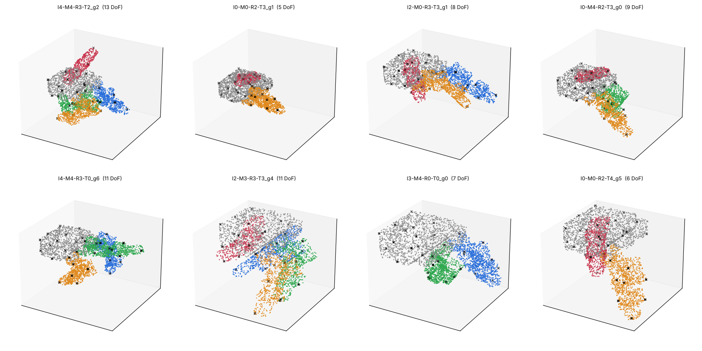
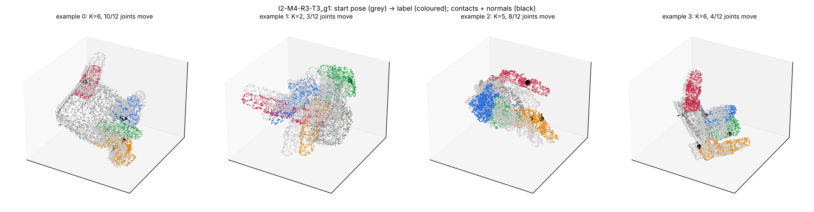

# GET Your KITE: training data

Synthetic kinematic training data for a single morphology-conditioned decoder on LEAP Hand variants. The project is described in [PROJECT_OVERVIEW.md](PROJECT_OVERVIEW.md) and the data plan in [DATA_GENERATION_PLAN.md](DATA_GENERATION_PLAN.md).

**Status:** the hand generator, splits and example sampler are done. z = ψ(contacts) is not stored: it can be computed from the stored contacts once a ψ exists (KITE's, or our own). This repo departs from PROJECT_OVERVIEW.md in a few places, all listed under [Deviations from the project overview](#deviations-from-the-project-overview). [What's left](#whats-left) lists the remaining work.

## Quickstart

```bash
./scripts/fetch_assets.sh            # pinned LEAP assets from GET-Zero and MuJoCo Menagerie -> third_party/
pip install -e ".[fast,dev]"         # fast = embreex (100x faster visibility rays)
pytest                               # ~30 s
python -m kite_data.build_hands      # all 243 topologies x 7 geometries -> data/hands/ (~4 min on 4 cores)
python -m kite_data.splits           # hand-level splits -> data/splits.json
python -m kite_data.generate         # 2.4M examples for every split -> data/examples/kite/ (~4 min, 850 MB)
python -m kite_data.qa hands I4-M4-R4-T4_g0 I3-M0-R2-T2_g1 --pose random   # data/qa/hands.png
python -m kite_data.qa examples data/examples/kite/val/I2-M4-R3-T3_g1.npz  # data/qa/examples.png
```

## Deviations from the project overview

PROJECT_OVERVIEW.md is unchanged. The data here differs from it in these ways:

| Topic | The overview says | This repo does | Why |
| --- | --- | --- | --- |
| How the hand variants are built | "variants of the LEAP Hand, the family GET-Zero used", made by "removing fingers or joints" | Our own generator, built on the base LEAP model. A finger with fewer joints keeps all its links; its joints are locked (made rigid) from the fingertip inward at 0 rad. GET-Zero's variant code is not used. | GET-Zero removes links, so fingers get shorter as they lose joints (index reach: 140 mm with 4 joints, 105 mm with 3, 88 mm with 2). A joint-count test on those hands would also be a length test. GET-Zero also has no continuous lengths, mount shifts or thumbless hands, and its repo has no license. GET-Zero's own hands are planned as an extra test set. |
| Link lengths | "0.8–1.2× per link" | Each of the five long links (three per main finger, two in the thumb) gets its own scale in [0.8, 1.2]. The three short motor-to-motor brackets and the palm keep their size. | The brackets have no single long axis. Stretching them would distort the motors and break the collision boxes. |
| Finger attachment | "Small shifts in where fingers mount on the palm" | Index, middle and ring mounts shift by up to ±4 mm along the palm, and their motor housings move with them. The thumb mount does not move. | The thumb's motor housing is fused into the palm mesh with no clear boundary to move. This was decided during the build. |
| Wrist poses in training | "w* ∈ arm workspace" | The wrist floats: uniform in [−0.4, 0.4]³ m with a uniformly random orientation (KITE's recipe). No arm is involved in training. | It matches what KITE's ψ and policy were trained on, keeps the data arm-agnostic, and needs no arm choice yet. Switching later only means regenerating. |
| Joint sampling | "θ* ∼ U(joint limits)" | Uniform within limits, but contact poses where the hand collides with itself are rejected, as KITE does. | A label pose that self-collides can't be realized. |
| What an example contains | (z, q_init, ρ_e, 𝒢_e) → q_goal, with z = ψ(c) | The raw contacts c (world-frame positions and normals) are stored instead of z. ρ_e and 𝒢_e come from each hand's `hand.json` and `Hand.graph()`. | KITE's ψ isn't released yet. z can be computed from c at load time once it is. |
| Finger-subset test | "Fingers never seen together, e.g. thumb + ring" | Hands whose fingers are exactly {thumb, ring} or {thumb, index, ring} are held out. Thumb and ring still appear together inside larger training hands. | Read literally, it would remove 144 of the 243 layouts, including every 4-finger hand. |

These are additions the overview leaves open; none changes anything it states:
- **Contact selection:** each contact picks the palm or a finger uniformly, then a point on it (KITE's rule).
- **Start-pose noise:** 5% of each joint's range, 5 mm and 5° on the wrist, clamped to joint limits (KITE's values).
- **Validation split:** a separate split for model selection.
- **Contact template:** 4,096 points per hand, with points inside the CAD parts filtered out.
- **Collision model:** MuJoCo Menagerie's collision boxes.
- **`wide` noise regime:** larger wrist noise for ablations; off by default.

What matches the overview:
- About 1M training examples (it says 0.5–1M).
- The four test splits.
- 2–4 fingers, each with 2–4 joints.
- Most hands keep the thumb (189 of 243 layouts).
- Data generation takes about 8 minutes on 4 cores; the overview estimated a few CPU hours.

Known approximations:
- **Collision misses:** the box collision model misses about 1.5% of real collisions; it agrees with exact meshes 95% of the time.
- **URDF visuals:** the URDF's visuals only approximate stretched links; its kinematics are exact.
- **Rotation noise:** the 5° wrist noise is applied per axis, giving about 8° on average. KITE's authors still need to confirm whether they meant that.

## The hand family

- **Topologies (243, 189 with a thumb).** Each finger (index, middle, ring, thumb) is absent or keeps 2, 3 or 4 joints, and every hand has at least 2 fingers. A finger with fewer joints keeps all its links, and its joints are locked from the fingertip inward at 0 rad. IDs read `I4-M3-R0-T2`.
- **Geometry.** Draw 0 is the nominal LEAP Hand. Draws 1 to 6 are random:
  - Each of the five long links (`mcp_joint`, `dip` and `fingertip` per finger; `thumb_dip` and `thumb_fingertip`) gets a length scale in [0.8, 1.2]. Only the middle of the link stretches, so motors and fingertip pads keep their shape.
  - The index, middle and ring mounts shift by up to ±4 mm along the palm, and their motor housings move with them.
  - A hand is redrawn if it collides at the zero pose or leaves less than 5% of random poses collision-free.
- **Hand IDs** are `<topology>_g<draw>`, e.g. `I4-M4-R4-T4_g0`.



*Eight random hands in random collision-free poses, drawn from their 4,096-point contact templates: palm grey, index blue, middle green, ring orange, thumb red; x = the 32 farthest-point samples.*

## Outputs (`data/hands/<hand_id>/`)

| File | Contents |
| --- | --- |
| `hand.json` | Descriptor: joints in canonical order (index, middle, ring, thumb; proximal to distal; locked joints flagged), origins, axes, limits, movable-parent indices, depth, leaf flags, links and their regions, geometry parameters, gate statistics and generator version. |
| `hand.xml` | Collision-only MJCF: MuJoCo Menagerie's hand-tuned boxes and fingertip pads, deformed with the geometry; palm fixed to the world. |
| `hand.urdf` | URDF with exact kinematics. Visuals reference the base meshes, with stretched links scaled approximately. |
| `template.npz` | 4,096 surface points (KITE's contact template): `link` (index into `link_names`), `pos` and `normal` (link frame), `region` (index into `region_names`), `fps` (32 farthest-point indices). |

`data/hands/index.csv` has one row per hand (DoF, fingers, gate result, collision-free rate, template points per region). `data/hands/summary.json` has build totals.

## Using a hand in code

```python
import numpy as np
from kite_data.build_hands import make_hand
from kite_data.collision import Collider

hand = make_hand("I3-M0-R2-T4", draw=2, seed=0, attempt=0)   # attempt: see hand.json["build"]
q = np.zeros(hand.n_dof)
frames = hand.fk(q)                    # link name -> 4x4 pose (palm = wrist frame)
p = hand.dof_link_poses(q)             # (n_dof, 4, 4): each movable joint's frame, the overview's p_j(q)
g = hand.graph()                       # shortest-path / ancestor / descendant matrices, wrist = node 0
free = not Collider(hand).collides(q)  # fast self-collision check (~0.3 ms)
```

## Splits (`data/splits.json`)

Splits are by hand, fixed before any example is sampled:

| Split | Hands | What it holds out |
| --- | --- | --- |
| `train` | 1,015 | 145 layouts, draws 0–6 |
| `val` | 56 | 8 other layouts, draws 0–6, for model selection only |
| `test_finger_subset` | 36 | Hands whose fingers are exactly {thumb, ring} or {thumb, index, ring}, nominal geometry |
| `test_combined` | 216 | The same layouts with random geometry (draws 1–6) |
| `test_joint_count` | 378 | Every other hand with a 3-joint index finger, draws 0–6 |
| `test_geometry` | 40 | 10 training layouts with geometries training never sees (draws 7–10) |

Thumb and ring still appear together in larger training hands; only the exact finger sets are held out.

## Training examples (`data/examples/kite/<split>/<hand_id>.npz`)

Each file holds one hand's examples, generated with KITE's recipe (KITE §IV-B, App. A):

1. A contact pose: finger joints uniform within limits, rejected if the hand self-collides. The wrist (KITE's floating base) is uniform in [−0.4, 0.4]³ m with a uniformly random orientation; no arm is involved in training.
2. K ~ U{2, …, 6} contacts. Each picks a non-empty region (palm or a finger) uniformly, then a template point uniformly within it, with replacement.
3. A start pose: joints perturbed by N(0, (5% of range)²) and clamped; wrist by 5 mm and 5° (per axis).
4. The label: joints upstream of a contact take the contact pose; all other joints stay at the start pose. The wrist takes the contact pose.

Default sizes are 1,000 examples per training hand (about 1M in total, as in the overview), 1,000 per validation hand and 2,000 per test hand; override with `--per-hand train=4000`. A `wide` regime (`--regime wide`) gives 20% of examples 5 cm / 30° wrist noise, for robustness ablations.

| Key | Shape | Contents |
| --- | --- | --- |
| `k` | (n,) | number of contacts, 2–6 |
| `template_idx` | (n, 6) | template points that make the contacts; −1 for unused slots |
| `contact_pos`, `contact_normal` | (n, 6, 3) | contact targets in the world frame (zero in unused slots) |
| `joints_contact`, `joints_init`, `joints_goal` | (n, n_dof) | finger joints in the hand's canonical order |
| `wrist_pos_*`, `wrist_quat_*` | (n, 3), (n, 4) | wrist (palm) pose for contact / init / goal; quaternions are w, x, y, z with w ≥ 0 |
| `mask` | (n, n_dof) | joints that move (upstream of a contact); the wrist always moves |
| `wide` | (n,) | whether the example used the wide noise regime |



*Four examples for one validation hand: the start pose (grey), the label (coloured; only joints upstream of a contact move) and the K contact targets with their outward normals (black).*

Before writing, every file is checked by re-deriving the contacts from the stored label (they agree to within 1e-7 m). The checks also confirm joint limits, the mask, the label and that contact poses don't collide. `kite_data.dataset.load_split("train")` loads a split into arrays padded to 16 joints (the 1M training examples load in ~5 s and take ~0.9 GB). The example view in `kite_data.qa` draws the start pose, the label and the contacts.

## What's left

**In this repo:**
1. **Import GET-Zero's own hands** as the extra test set. The files are already fetched; the converter isn't written.
2. **Add z** once a ψ exists: KITE's when its code arrives, or our own. Computing it at load time may be enough, with no stored cache.
3. **Re-check against KITE's code** when it arrives, then regenerate if anything differs (about 8 minutes). Things to compare:
   - how the 4,096 template points and finger/palm regions are chosen;
   - which collision pairs are checked;
   - the rotation-noise convention;
   - where the world origin sits.
4. **Training data for the test hands**, if an upper bound is chosen. `generate.py` can produce it under a new split name with its own seeds.
5. **A dataset QA report:** distributions of contacts, K, mask density and regions per split, plus an audit that re-checks a sample of contact poses against exact meshes.
6. **Differentiable (PyTorch) batched FK** over these hand descriptors, needed by the contact and self-model losses. It could live here or with the training code.

**Decisions still open** (details in [DATA_GENERATION_PLAN.md](DATA_GENERATION_PLAN.md), section 3):
- **Upper bound:** which one to compare against: a re-implemented KITE decoder per test hand, the GET decoder trained with the test hands, or none.
- **Length range:** keep 0.8–1.2 and use GET-Zero's +1.5 cm parts as an extrapolation test (recommended).
- **Training budget:** run a scaling test to set the GPU budget and the examples per hand.
- **Contact loss:** tie it to the labelled points or make it assignment-free.
- **Wide-noise ablation:** whether to run it.
- **Evaluation details:** the success tolerance and the IK solver.

**Waiting on KITE's code and data:**
- ψ's weights, for z.
- The task policy π and its demonstrations, for the oracle-intent and closed-loop evaluation modes.
- Their scenes and world-frame convention.

**Outside this repo:**
- The GET decoder and its training.
- The evaluation pipeline: open-loop metrics, oracle intent, and closed-loop MuJoCo with an arm, IK and a position controller.

## Third-party assets

These are not committed. `scripts/fetch_assets.sh` fetches them at pinned commits:
- **GET-Zero** (`real-stanford/get_zero` @ `279652d`): the base LEAP URDF and meshes. Its repository has no license file, so nothing from it is copied into this repo.
- **MuJoCo Menagerie** (`google-deepmind/mujoco_menagerie` @ `b065505`, `leap_hand/`, MIT): collision boxes and fingertip pad meshes.

The papers are listed in [reference/](reference/README.md).
